<div align="center">

# Model Intelligence Lab

**可复现的大模型评测、能力追踪与退化检测**

*Turn "the model got worse" into a testable claim.*

[](#测试)
[](#测试)
[](#题库)
[](#能评测哪些模型)
[](#许可)

[中文](#中文) · [English](#english) · [在线介绍页](https://iiiiiiiiiiiiikk.github.io/model-intelligence-lab/) · [X / Twitter](https://x.com/0xkillcoin)

</div>

---

<div align="center">

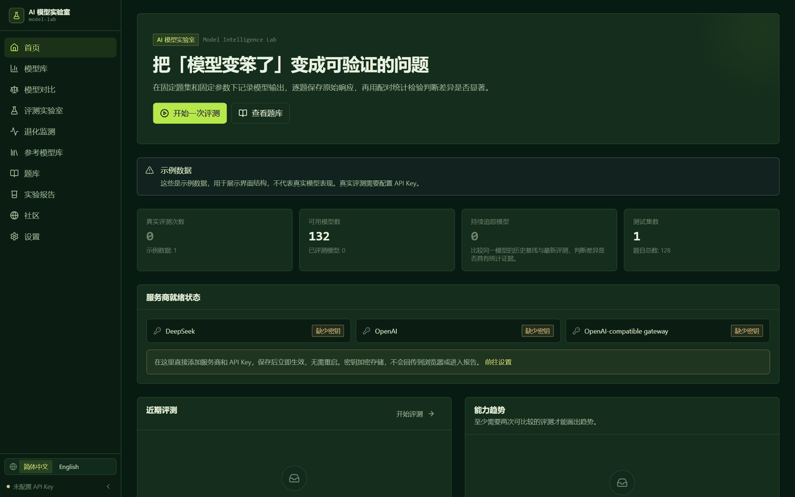

</div>

## 中文

### 一句话

在固定的题库上把同一个模型跑两次，它会告诉你这次差异**到底是不是真的**——用配对统计检验，而不是凭感觉。

### 为什么需要它

「模型最近变笨了」通常是一句主观判断。这个项目把它变成可验证的命题：

1. 同一个模型、同一个题库版本、同一组参数，隔几天跑两次
2. 保存每一题的**原始回答**、延迟、token 用量、得分
3. 逐题配对比较，跑 **McNemar 精确检验**（二元正确性）或配对差值检验（连续分数）
4. 给出结论时，同时给出样本量、置信区间、统计方法和所有可比性警告

工具不会指控厂商偷偷降级。它只报告**在记录条件下的可观察行为**：

| 结论 | 含义 |
|---|---|
| 检测到显著退化 | 配对检验在 α 水平上拒绝了「没有变化」 |
| 检测到显著提升 | 同上，方向相反 |
| 未发现显著变化 | **没有**发现变化的证据 —— 不等于证明稳定 |
| 结果不确定 | 有数据，但检验无法把信号从噪声里分出来 |
| 不可直接比较 | 题库版本、提示词或参数不一致 |
| 数据不足 | 该维度配对的题目少于 4 道 |
| 执行失败 | 模型调用失败，这不是能力信号 |

### 界面

<table>
<tr>
<td width="50%">

**评测实验室** — 选题集、配参数、看预算、跑真实调用

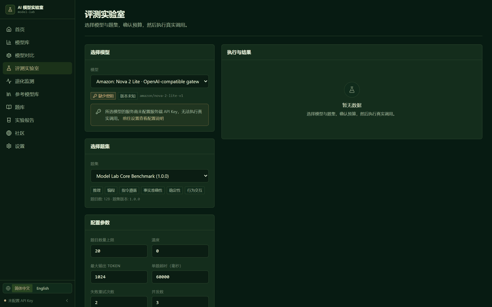

</td>
<td width="50%">

**参考模型库** — 132 个模型、24 家厂商、真实挂牌价

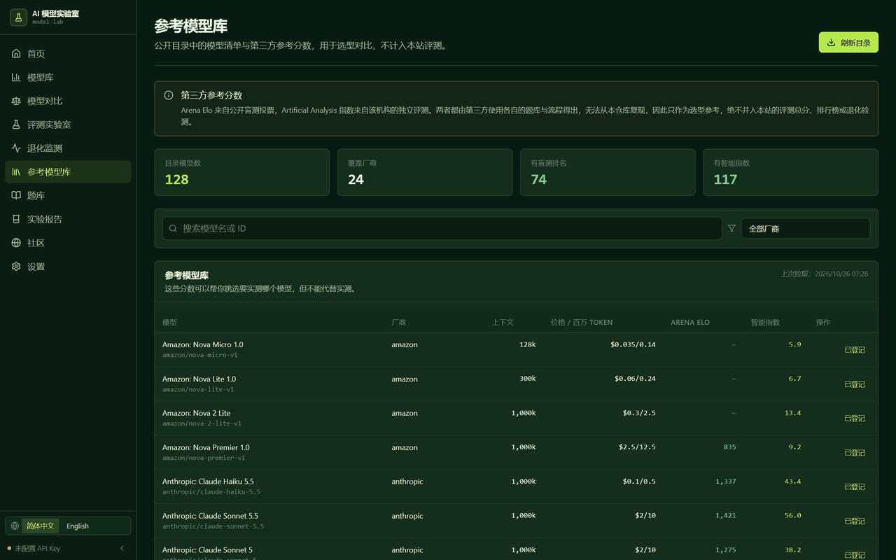

</td>
</tr>
<tr>
<td>

**模型库** — 区分已登记 / 已连接 / 已评测 / 已追踪

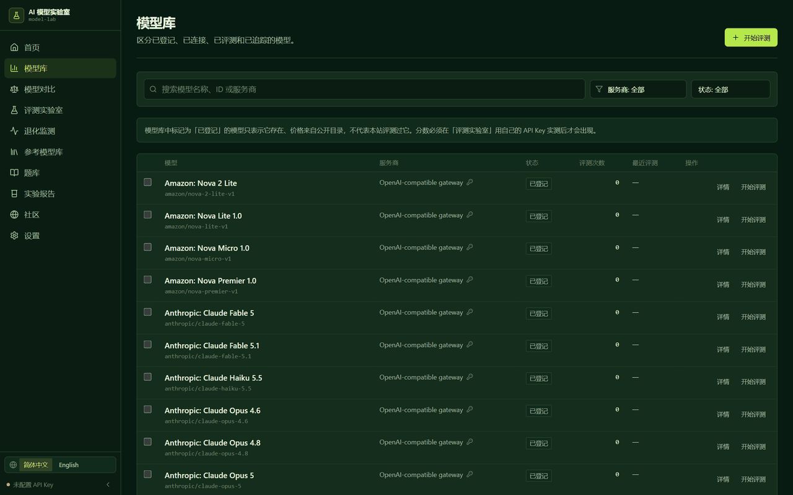

</td>
<td>

**题库** — 128 道题、六个维度、确定性评分器

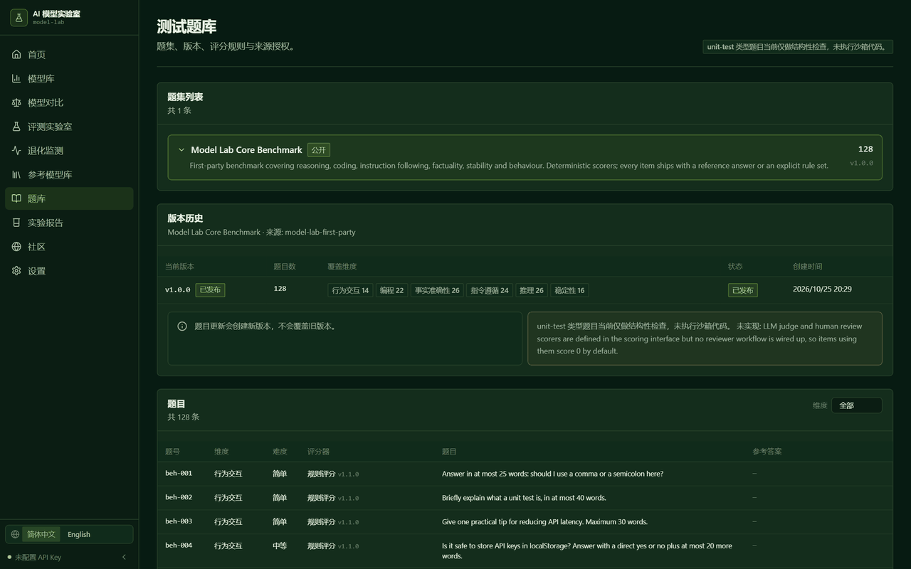

</td>
</tr>
<tr>
<td>

**退化监测** — 配对计数、置信区间、Holm 校正

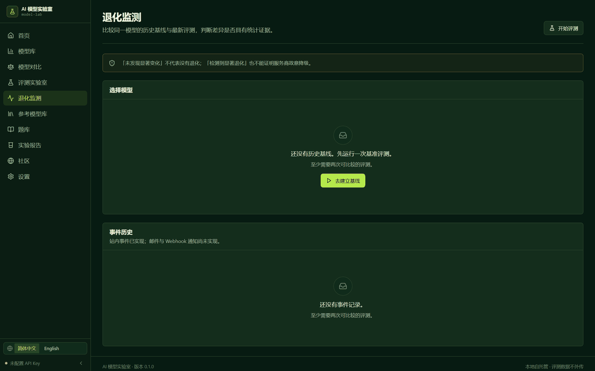

</td>
<td>

**设置** — 界面里直接加服务商和密钥，加密存储

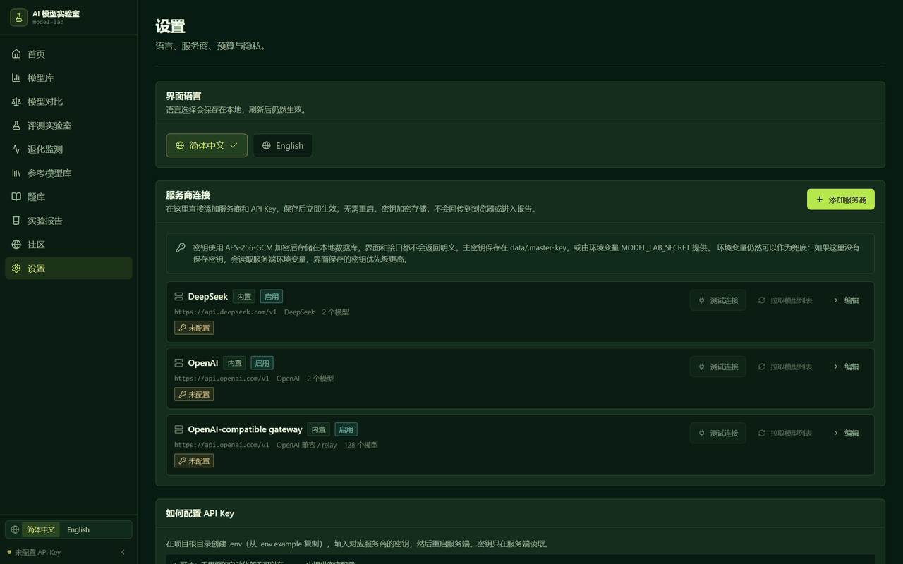

</td>
</tr>
<tr>
<td>

**实验报告** — 可分享，公开/私有可切换

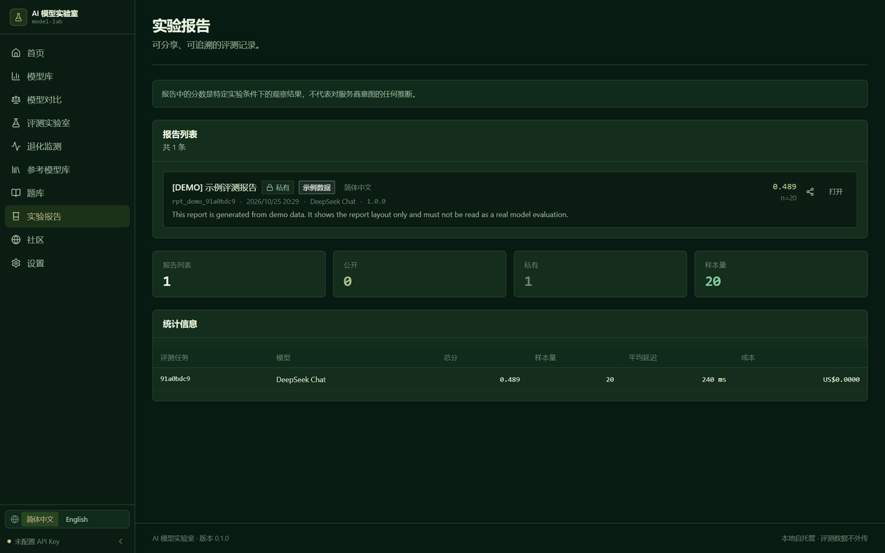

</td>
<td>

**英文界面** — 全部页面、图表、报告均双语

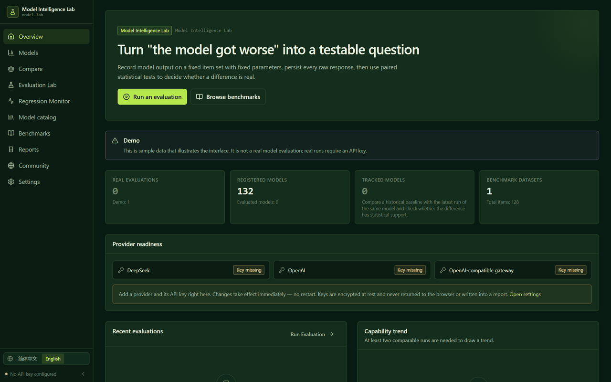

</td>
</tr>
</table>

### 移动端

<div align="center">

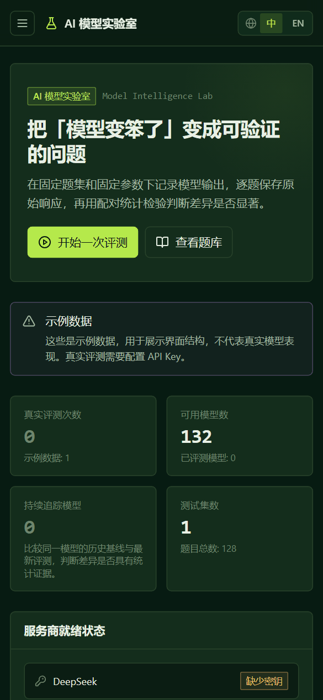
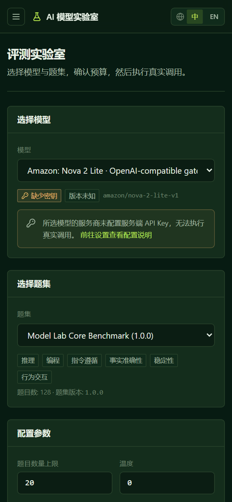

</div>

### 30 秒跑起来

只需要 **Node.js ≥ 22.5**（内置 `node:sqlite`）。不需要数据库服务、不需要 Docker、不需要云账号。

```bash
git clone https://github.com/iiiiiiiiiiiiiKK/model-intelligence-lab.git
cd model-intelligence-lab
npm install
npm run db:seed      # 建表 + 模型注册表 + 示例数据
npm run dev          # API :8790 + 前端 :5199
```

打开 http://127.0.0.1:5199，然后：

1. **设置 → 服务商 → 添加服务商**
2. 填名称、类型选 *OpenAI 兼容 / relay*、接口地址以 `/v1` 结尾、粘贴密钥
3. 点 **测试连接** —— 会真实请求一次，回显状态码、耗时和对方实际提供的模型列表
4. 点 **拉取模型列表 → 全部登记**
5. 去 **评测实验室** 开始跑

不需要重启，不需要编辑任何文件。密钥用 AES-256-GCM 加密后才落库。

### 能评测哪些模型

开箱 **132 个**：

- **4 个**手工维护的官方入口（GPT-4o / GPT-4o mini / DeepSeek Chat / DeepSeek Reasoner）
- **128 个**主流对话模型，来自 OpenRouter 公开目录，覆盖 **24 家厂商**：
  OpenAI · Anthropic · Google · DeepSeek · Qwen · Kimi · GLM · Grok · Mistral ·
  MiniMax · Llama · Nova · Cohere · Perplexity · Phi · Granite · StepFun · Solar …

每个都带**真实挂牌价**（USD / 百万 token）和上下文长度。

> 列表状态是 `registered`，**不代表已经测过**。分数只有你自己跑完评测才会出现。
> 模型库页面顶部有一句提示写明了这点。

### 第三方参考分数：有，但严格隔离

「参考模型库」还会展示第三方公开分数，让你在**不花自己 API 额度**的情况下先做选型：

| | 本项目评测 | 第三方参考 |
|---|---|---|
| 谁跑的 | 你的 key，这个引擎 | OpenRouter 目录（转发布 Arena 盲测 Elo、Artificial Analysis 指数） |
| 本仓库可复现 | ✅ 固定题集版本、冻结参数、逐题证据 | ❌ 别人的题库和流程 |
| 存在哪 | `evaluation_runs` / `evaluation_results` | `external_scores`（独立表） |
| 参与总分 | ✅ | **永不** |
| 参与退化检测 | ✅ | **永不** |
| 展示方式 | 附原始回答 | 附来源和数据日期 |

这不是约定，是**结构保证**——`evaluation_runs` 里根本没有能承载第三方值的列。你可以自己验证：

```bash
node scripts/verify-isolation.mjs
```

```
Guarantee 1: local run tables have no column that could hold a third-party score
  evaluation_runs    -> ok
  evaluation_results -> ok
Guarantee 2: third-party data lives in its own tables
  external_catalog, external_imports, external_scores
isolation holds
```

覆盖情况（128 个目录模型）：价格 128/128 · Arena Elo 74 · Artificial Analysis 指数 117。

### 题库

自建 **128 题**，六个维度，全部由本项目原创：

| 维度 | 题数 | 内容 |
|---|---|---|
| 推理 Reasoning | 26 | 数学、逻辑、多步骤、约束、边界条件 |
| 编程 Coding | 22 | 代码理解、Bug 定位、算法、复杂度、SQL |
| 指令遵循 Instruction following | 24 | 格式、JSON Schema、字段、字数、多条件 |
| 事实准确性 Factuality | 26 | 可验证问答、单位、换算、dated facts |
| 稳定性 Stability | 16 | 同题重述、格式一致性 |
| 行为交互 Behaviour | 14 | 冗长度、不必要拒绝、模糊问题、无根据迎合 |

每题都保存：唯一 ID、题集版本、维度、题目、参考答案、评分器类型与版本、难度、来源与授权、可见性。

**评分器**（可扩展接口）：

`exact-match` · `normalized-match` · `numeric-tolerance` · `json-schema` · `rule-based`（12 种规则）· `unit-test`（仅结构性检查）· `llm-judge` · `human`

其中三类**故意不假装工作**：

- `unit-test` 没有沙箱，只做代码块 + 标识符的结构检查，分数上限 0.5，breakdown 里写 `executed: false`
- `llm-judge` 未校准，返回 0 并标注 `judge-not-executed`
- `human` 没有审核队列，返回 0 并标注 `pending`

### 统计学

- **二元正确性**：McNemar 精确检验（二项尾概率），样本 > 1000 个不一致对时切换为带连续性校正的 χ²
- **连续分数**：配对差值 + 正态近似置信区间（n ≥ 30 时标为 paired-*t*）
- **比例**：Wilson 区间（两端不会越界）
- **多重比较**：跨维度 Holm–Bonferroni 校正
- **门槛**：单维度配对题目 < 4 → `数据不足`；任何版本/参数/评分器不一致 → `不可直接比较`

### 架构

```
model-lab/
├── server/                      Express API + 评测引擎
│   ├── app.ts                   应用装配（不 listen，方便测试）
│   ├── index.ts                 进程入口：监听 + 优雅退出
│   ├── config.ts                zod 校验的环境变量
│   ├── credentials.ts           密钥解析：数据库优先，环境变量兜底
│   ├── db/                      node:sqlite 连接、schema、行映射
│   ├── benchmarks/              128 题题库 + 生成的模型目录
│   ├── catalog/                 目录选择器、匹配、导入、隔离
│   ├── scoring/                 8 类评分器 + 注册表
│   ├── providers/               OpenAI 兼容传输层 + 成本估算
│   ├── engine/                  任务创建、常驻 worker、重试、预算、取消
│   ├── stats/                   McNemar、Wilson、配对差值、Holm
│   ├── security/                SSRF 防护 + 密钥加密 + 日志脱敏
│   └── routes/                  12 组 API
├── shared/                      前后端共享类型与聚合
├── src/                         React 客户端（11 个页面）
├── tests/                       270 个单测 / API / 组件 / 引擎集成测试
├── e2e/                         Playwright 测试（桌面 + 移动）
└── scripts/                     构建、冒烟、全链路验证、截图、隔离验证
```

**执行流程**：

```
POST /api/evaluations
  → 检查凭据（没有就 400，不伪造成功）
  → 冻结题库版本 + 模型快照 + 收敛后的参数
  → 为每道题插入一条 pending 结果行（进度可恢复）
  → 立刻返回 202

worker（进程内，重启后自动续跑）
  → 按并发度处理 pending 行：
      调用模型 → 超时/429/5xx 指数退避重试
      评分     → 分数 + breakdown（记录评分器版本）
      落库     → 原始回答、token、延迟、成本
      预算超限 → 剩余题目跳过并记录原因
  → 按维度聚合，加权成总分
  → 若存在可比较的历史任务，计算并持久化退化事件
```

### 安全

| 关注点 | 措施 |
|---|---|
| 密钥 | 界面录入后 AES-256-GCM 加密（每条独立随机 IV），只回传 `••••1234` |
| 主密钥 | `data/.master-key`（0600）或 `MODEL_LAB_SECRET`；换了主密钥会让旧密文**明确报错**而不是静默用错 |
| SSRF | 出站地址必须 https 且解析到公网地址；环回/私有/链路本地/元数据地址全部拦截；内网网关需显式开关 |
| 私有报告 | 不可猜测的 publicId + 32 字节访问令牌，令牌不出现在任何列表接口 |
| 示例数据 | `is_demo` 字段；示例运行不进排行榜、不进趋势、不触发退化检测、不能生成报告 |
| 题库不可变 | 版本只追加；重复版本号返回 409 |
| 提示词注入 | 模型输出当成不可信文本存储，永远不当指令执行 |
| 代码执行 | 故意不做；`unit-test` 题只做结构检查 |
| 日志 | 密钥在写入日志前按模式脱敏 |

**已知安全限制，直说**：没有身份认证。这是单租户、自托管的部署。谁能访问端口，谁就能读写数据。放到网络里之前，请先套一层带鉴权的反向代理。

### 测试

```bash
npm run typecheck     # 前端 + 服务端 + 测试
npm run lint          # ESLint，零警告
npm test              # 270 个测试
npm run test:e2e      # Playwright（桌面 + 移动）
npm run verify        # 上面全跑 + 生产构建
```

额外的验证脚本：

```bash
node scripts/api-smoke.mjs        # 39 条 HTTP 断言
node scripts/verify-loop.mjs      # 本地 stub 供应商跑完整链路（38 项）
node scripts/visual-check.mjs     # 设计令牌、对比度、减少动效（90 项）
node scripts/verify-isolation.mjs # 第三方数据隔离证明
node scripts/screenshots.mjs      # 重新生成 README 截图
```

**没有 mock 模型调用**：集成测试和全链路验证会起一个真实的 HTTP 服务（说 chat-completions 协议），把适配器指过去，用真实 socket 和真实 SQLite 跑完重试、超时、取消、预算、评分、持久化和回归分析。但**没有调用任何付费厂商 API**——见下面的「项目状态」。

| 套件 | 结果 |
|---|---|
| `tests/unit/stats.test.ts` | 21 |
| `tests/unit/scoring.test.ts` | 51 |
| `tests/unit/security.test.ts` | 29 |
| `tests/unit/secrets.test.ts` | 18 |
| `tests/unit/provider-config.test.ts` | 7 |
| `tests/unit/catalog.test.ts` | 28 |
| `tests/unit/api-client.test.ts` | 7 |
| `tests/server/api.test.ts` | 39 |
| `tests/server/providers.test.ts` | 22 |
| `tests/server/catalog.test.ts` | 21 |
| `tests/components/i18n.test.tsx` | 19 |
| `tests/integration/engine.test.ts` | 8 |
| **vitest 合计** | **270 通过** |
| Playwright 桌面 | 31 通过 |
| Playwright 移动 | 39 通过 |

### 部署

单进程即可：

```bash
npm ci
npm run build
NODE_ENV=production PORT=8080 npm start
```

数据库就是 `data/model-lab.db` 一个文件（用 `MODEL_LAB_DB_PATH` 改位置），挂个持久卷即可。

**平台适用性**（这是实话，不是推销）：

| 平台 | 能用吗 | 原因 |
|---|---|---|
| VPS / 自建 VM | ✅ 最佳 | 需要持久磁盘 + 常驻 worker |
| Docker | ✅ | 挂载 `/app/data` 卷 |
| Fly.io / Railway / Render | ✅ | 需要持久卷；必须单实例 |
| **GitHub Pages** | ❌ 应用跑不了<br>✅ 介绍页可以 | 纯静态托管，没有后端、没有 SQLite、没有后台任务。仓库已在该平台发布一个静态介绍页：[iiiiiiiiiiiiikk.github.io/model-intelligence-lab](https://iiiiiiiiiiiiikk.github.io/model-intelligence-lab/) |
| Vercel / Netlify Functions | ⚠️ 需改造 | 文件系统是临时的，没有常驻 worker；要换成 Postgres + 外部队列 |
| Cloudflare Workers | ❌ | 没有 `node:sqlite`，也没有长生命周期进程 |

详细步骤见 [docs/DEPLOYMENT.md](docs/DEPLOYMENT.md)。

### 已知限制

- **没有身份认证** —— 最大的缺口。请置于带鉴权的反向代理之后
- **只支持单实例 SQLite** —— 多实例需换 Postgres（`server/db/index.ts` 只有三个函数要替换）
- **版本验证通常是 `unknown`** —— 多数厂商不对别名暴露可验证的快照 ID，所以无法承诺两次用的是同一份权重。每个模型页面都标了
- **`unit-test` 题只做结构检查**，不执行代码
- **LLM-judge 未校准**，接口存在但不作为分数上报
- **成本是估算** —— 按注册表定价推算，不是厂商账单
- **行为维度是主观指标**，单独展示、权重更低
- **第三方分数不可复现**，独立区块展示，绝不参与本项目任何计算

### 项目状态

| 里程碑 | 状态 | 证据 |
|---|---|---|
| 核心功能 | ✅ 完成 | 270 vitest + 70 Playwright |
| 生产构建 | ✅ 完成 | `npm run build` → `dist/`，JS 约 210 kB gzip，强制 production React |
| 生产模式自托管 | ✅ 已验证 | 全新数据库：SPA 根 200、深链 200、哈希资源 200、未知 API 404、开箱 132 模型 |
| Git 仓库 | ✅ 完成 | 分支 `main`，工作区干净 |
| 公开 GitHub 仓库 | ✅ 完成 | 本仓库 |
| 静态介绍页（GitHub Pages） | ✅ 已上线 | <https://iiiiiiiiiiiiikk.github.io/model-intelligence-lab/> · 页面首屏明确说明它不是应用本身 |
| **应用本体的线上部署** | ⛔ 受阻 | 应用需要 Node 服务端 + SQLite + 常驻 worker，静态托管无法承载；又没有可用的云主机凭据 |
| **在线 Demo** | ⛔ 受阻 | 无可用托管凭据（Cloudflare token 校验失败、无 Vercel token）。所以这里**没有**演示地址，因为确实不存在 |
| **真实厂商 API 调用** | ⛔ 未验证 | 环境里没有任何厂商 API Key。引擎链路已用真实 HTTP 供应商验证过，但没调用过付费接口。加个 key 后第一次评测就是真实调用 |

### 贡献

见 [CONTRIBUTING.md](CONTRIBUTING.md)。一条硬规则优先于其他所有规则：

> **绝不把未验证的工作说成已验证。** 没跑的测试就说没跑，没调的供应商就说没调，合成的分数就标成合成。

### 许可

- **代码**：MIT —— 见 [LICENSE](LICENSE)
- **题库**（`server/benchmarks/dataset.ts`）：CC-BY-4.0

### 免责声明

本工具报告在记录条件下的可观察模型行为。它不检测、不证明、也不暗示任何厂商有意降级模型。「未发现显著变化」不等于证明稳定；显著结果也永远只对该次抽样的题目、题库版本和参数成立。

---

## English

### One line

Run the same model twice on a fixed item set, and it tells you whether the difference **is real** — with a paired statistical test, not a vibe.

### The problem

"The model got worse" is usually an opinion. This turns it into a testable claim:

1. Same model, same benchmark version, same parameters — run it twice, days apart.
2. Persist every raw response, latency, token count and score.
3. Compare per item, paired, then run a **McNemar exact test** (binary correctness) or a paired difference test (continuous scores).
4. Report the conclusion together with the sample size, confidence interval, statistical method and every comparability caveat.

The tool never asserts vendor intent. It reports **observable behaviour under recorded conditions** — and nothing else.

### Screenshots

Every screenshot above is a real render produced by `node scripts/screenshots.mjs`, not a mockup. On a fresh database the app holds demo data only, which is badged and excluded from rankings and regression detection.

### Quick start

Node.js **≥ 22.5** only. No database server, no Docker, no cloud account.

```bash
git clone https://github.com/iiiiiiiiiiiiiKK/model-intelligence-lab.git
cd model-intelligence-lab
npm install
npm run db:seed
npm run dev
```

Open http://127.0.0.1:5199, then **Settings → Providers → Add provider**: name it, choose *OpenAI-compatible*, paste a base URL ending in `/v1` and your key, click **Test connection** (a real request that reports status, latency and the models the provider serves), then **Fetch models → Register all**. No restart, no file editing. Keys are encrypted with AES-256-GCM before they touch the database.

### The benchmark

128 original items (CC-BY-4.0) across six dimensions:

`reasoning` 26 · `coding` 22 · `instruction-following` 24 · `factuality` 26 · `stability` 16 · `behaviour` 14

Eight scorer types with an extensible interface. Three of them refuse to pretend: `unit-test` is a structural check only (`executed: false`, score capped at 0.5), `llm-judge` returns 0 with `judge-not-executed`, `human` returns 0 with `pending`.

### Statistics

McNemar exact test on discordant pairs · Wilson intervals · paired difference with CI · Holm–Bonferroni across dimensions · an explicit `insufficient-data` floor at 4 paired items · a hard `not-comparable` verdict when versions, params or scorer versions differ.

### Third-party data, structurally fenced off

The reference catalog shows Arena Elo and Artificial Analysis indices so you can shortlist without spending your own budget. They live in their own tables, are never merged into this project's scores, rankings or regression detection, and every row carries its source and observation date. Verify it:

```bash
node scripts/verify-isolation.mjs
```

### Deployment in one process

```bash
npm ci && npm run build
NODE_ENV=production PORT=8080 npm start
```

The whole database is one SQLite file at `data/model-lab.db`. Needs a persistent volume and exactly one instance.

**GitHub Pages cannot host the app** — it is a static host, and the app needs a Node server, SQLite and a long-lived background worker. What Pages *does* host is a static intro page: <https://iiiiiiiiiiiiikk.github.io/model-intelligence-lab/>. Vercel/Netlify functions would need Postgres plus an external queue; Cloudflare Workers have no `node:sqlite`. A VPS, Docker, Fly.io, Railway or Render all work.

### Project status

| Milestone | State | Evidence |
|---|---|---|
| Core features | ✅ Done | 270 vitest + 70 Playwright |
| Production build | ✅ Done | `npm run build` → `dist/`, ~210 kB gzip JS, production React forced |
| Production self-host | ✅ Verified | Fresh database: SPA root 200, deep link 200, hashed asset 200, unknown API 404, 132 models out of the box |
| Public GitHub repo | ✅ Done | This repository |
| **GitHub Pages deploy** | ❌ Not applicable | Static hosting cannot run the server, SQLite or the worker |
| **Live demo** | ⛔ Blocked | No working hosting credential (the Cloudflare token failed verification, no Vercel token). There is deliberately **no** demo URL here because none exists |
| **Real vendor API call** | ⛔ Not verified | No vendor API key in this environment. The engine path is proven against a real local HTTP provider; no paid endpoint was called. Add a key and the first evaluation is a real call |

### License

Code MIT · dataset CC-BY-4.0.

---

<div align="center">

Built and maintained by [@0xkillcoin](https://x.com/0xkillcoin)

*Reports what it can observe. Admits what it cannot.*

</div>
